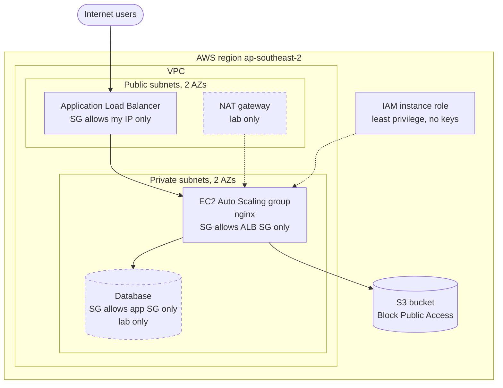

# AWS-break-fix-platform

A multi-AZ web platform on AWS that I built, secured, **broke on purpose, and
repaired**, writing a post-incident report for each failure. Built to practice the
daily work of a cloud support engineer.

**Region:** ap-southeast-2 (Sydney) | **Services:** EC2, ALB, Auto Scaling, VPC, IAM,
S3, RDS, CloudWatch, CloudTrail, SNS

## Architecture

Dashed boxes were deployed only for short lab sessions. To control cost, some labs
ran instances in public subnets, and the NAT gateway and database existed only while
needed.

## Incident reports
Each report has the same format: timeline, symptom, hypotheses, evidence checked (with
what each check ruled out), root cause, fix, prevention, and lessons.

| # | Incident | Key lesson | Report |
|---|----------|-----------|--------|
| 1 | S3 bucket policy lockout | An explicit Deny beats every Allow, even for admins | [Report](runbooks/01-s3-lockout.md) |
| 2 | Web server timeout (security group) | A timeout means packets are dropped before the app | [Report](runbooks/02-sg-timeout.md) |
| 3 | EC2 denied access to S3 (IAM policy typo) | "No identity-based policy allows" means a missing Allow | [Report](runbooks/03-iam-s3-denied.md) |
| 4 | Disk full on EC2 (CloudWatch alarm) | Green status checks do not mean a healthy app | [Report](runbooks/04-disk-full.md) |
| 5 | Web server timeout (missing internet route) | A subnet is public because of its route table | [Report](runbooks/05-missing-route.md) |
| 6 | ALB 504: unhealthy targets (security group chain) | 5xx points behind the load balancer; "timed out" means a network block | [Report](runbooks/06-alb-504-unhealthy-targets.md) |
| 7 | Wrong health check path (ASG replacement loop) | A 404 in target health means the server answered | [Report](runbooks/07-bad-health-check-path.md) |
| 8 | Private subnet lost internet (missing NAT route) | A healthy NAT is useless without a route to it | [Report](runbooks/08-missing-nat-route.md) |
| 9 | App can't reach the database (security group) | A timeout cannot tell a blocked DB from a stopped one | [Report](runbooks/09-db-sg-timeout.md) |
| 10 | Database stopped (incident response) | Alerts and time to recovery matter | [Report](runbooks/10-rds-stopped.md) |
| 11 | CPU spike, ASG scaling, and instance replacement | An ASG with EC2 checks replaces dead hosts, not dead apps | [Report](runbooks/11-cpu-spike-autoscaling.md) |

## What I learned
- Troubleshoot by layer (host, app, security group, network ACL, route, dependency) and
  write down what each check rules out
- The same symptom can have different causes (incidents 2 and 5 both time out)
- Read error messages closely: they name the principal, the action, and the resource
- Monitoring needs both change alarms and symptom alarms
- Green health checks can hide a dead application

## Cost and safety
Everything ran inside the AWS Free plan. Billed resources (NAT gateway, load balancer,
database, instances) were created for short sessions and deleted afterward. No access
keys were used: instances use IAM roles, and shell access used Session Manager.

## Repository layout
- `runbooks/` incident reports and the report template
- `iam/` policy JSON
- `screenshots/` redacted evidence

## What I would do next
Terraform for the whole stack, remote state, HTTPS with a certificate, a WAF, and
automated config checks.
