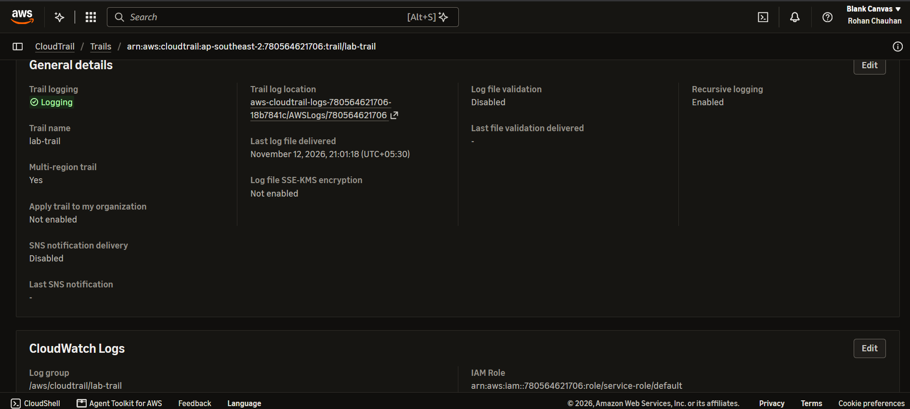
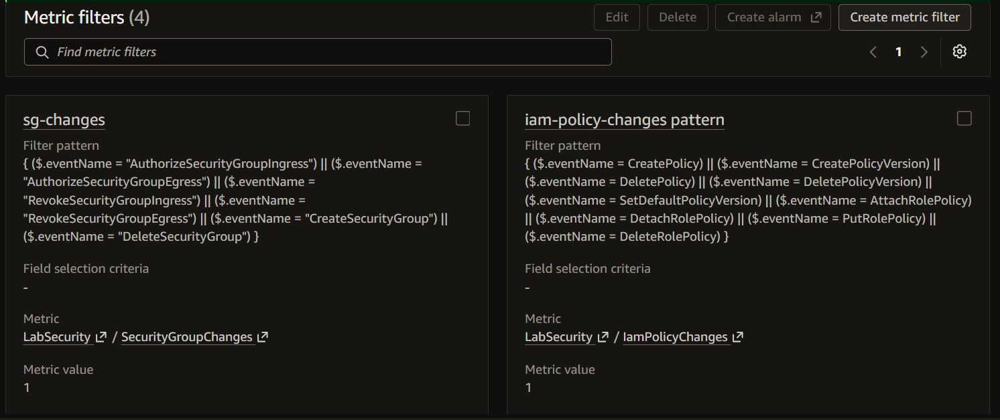
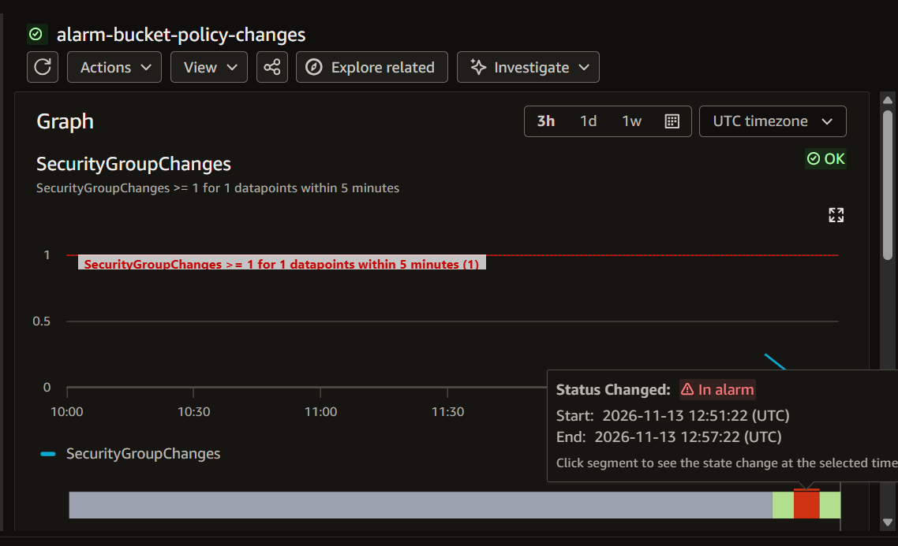
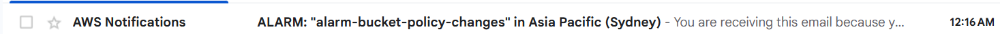
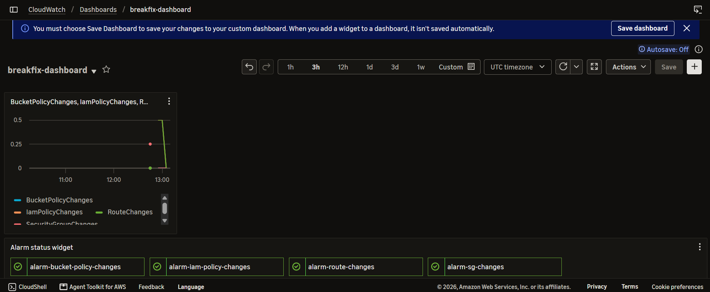

# Monitoring and detection

Region: ap-southeast-2. Alerts go to SNS topic `breakfix-alerts` (email).

## What is built
| Signal | How | Alarm |
|---|---|---|
| Security group changes | CloudTrail -> CloudWatch Logs -> metric filter | alarm-sg-changes |
| IAM policy changes | Same pipeline | alarm-iam-policy-changes |
| Route table changes | Same pipeline | alarm-route-changes |
| S3 bucket policy changes | Same pipeline | alarm-bucket-policy-changes |
| nginx 5xx responses | CloudWatch agent log shipping + metric filter | alarm-nginx-5xx |
| Disk usage | CloudWatch agent metric (Break 4) | break4-disk-high |
| RDS availability | RDS event subscription (Lab 10) | Email via SNS |

## How each incident would have been detected
| Incident | Detected by | Status |
|---|---|---|
| 01 Bucket policy lockout | alarm-bucket-policy-changes | Built |
| 02 Security group rule removed | alarm-sg-changes | Built |
| 03 IAM policy typo | alarm-iam-policy-changes | Built |
| 04 Disk full | break4-disk-high | Built (Break 4) |
| 05 Missing internet route | alarm-route-changes | Built |
| 06 ALB 504 | UnHealthyHostCount alarm on the ALB | Design only |
| 07 Bad health check path | ModifyTargetGroup change alert and UnHealthyHostCount | Design only |
| 08 Missing NAT route | alarm-route-changes | Built |
| 09 Database SG rule removed | alarm-sg-changes | Built |
| 10 RDS stopped | RDS event subscription | Built (Lab 10) |
| 11 CPU spike | Target-tracking alarms and a CPU alarm | Built (Lab 11) |

## Notes
- Change alarms detect the cause; symptom alarms (5xx, unhealthy hosts, disk) detect the impact. Both are needed.
- Log groups have 1 week retention to control cost.
- Dashboard definition: `dashboard.json`.

## Screenshots

