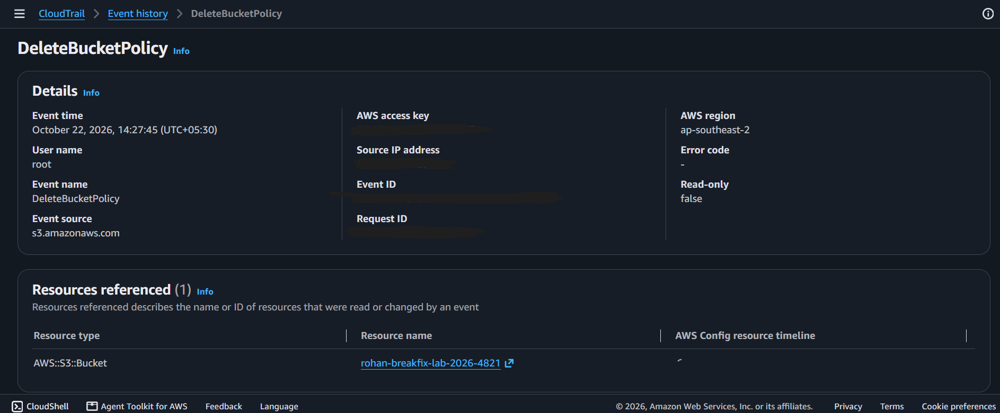

# Incident 01: S3 bucket lockout from an explicit Deny

**Severity:** Low (lab bucket) | **Region:** ap-southeast-2

## Timeline
- Bucket created (CreateBucket, PutBucketEncryption), working normally
- PutBucketPolicy applied a bucket policy (CloudTrail)
- Console began returning "Insufficient permissions to list objects"
- Root privileged session deleted the bucket policy (DeleteBucketPolicy, CloudTrail)
- Access restored

## Symptom
The bucket's Objects tab showed "Insufficient permissions to list objects,"
suggesting a missing s3:ListBucket permission. Admin-level access was also denied
on bucket settings (s3:GetBucketPublicAccessBlock).

## Hypothesis
1. My IAM identity lost S3 permissions
2. A bucket policy is denying access

## Evidence checked
- Amazon Q console diagnosis: the failing identity was AccountFullAccessRole
  (full admin), denied by an explicit Deny on the resource. Q's analysis and
  resolution text were inconsistent, so I verified independently.
- CloudTrail Event history: PutBucketPolicy was the last change before the failure.
- No IAM changes had been made.

## Root cause
A bucket policy with "Effect": "Deny", "Principal": "*", "Action": "s3:*" and no
condition exempting administrators. An explicit Deny overrides every Allow,
including full-admin permissions.

## Fix
Used IAM > Root access management > Delete S3 bucket policy (privileged root
session). CloudTrail shows DeleteBucketPolicy by root with no error code.

## Prevention
- Never write an unconditioned Deny on Principal "*"
- Add a condition that exempts an admin role (for example aws:PrincipalArn)
- Review policies with IAM Access Analyzer before saving
- Alert on PutBucketPolicy events via CloudTrail

## What I learned
- Evaluation order: explicit Deny > explicit Allow > implicit deny
- The console message pointed to a missing Allow, but the cause was a Deny
- Console error text is a starting point, not a diagnosis
  ## Evidence

**Failure**

**Recovery**

