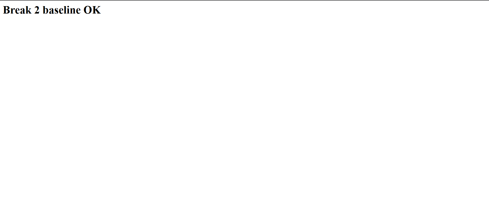
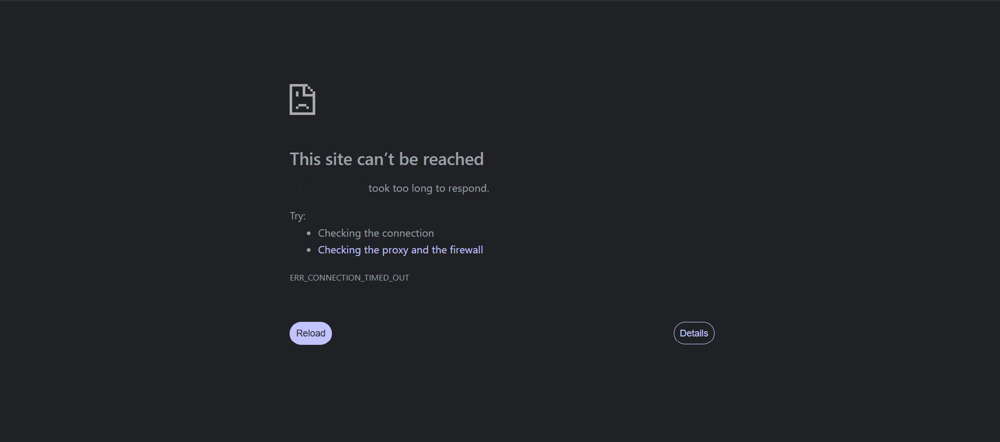
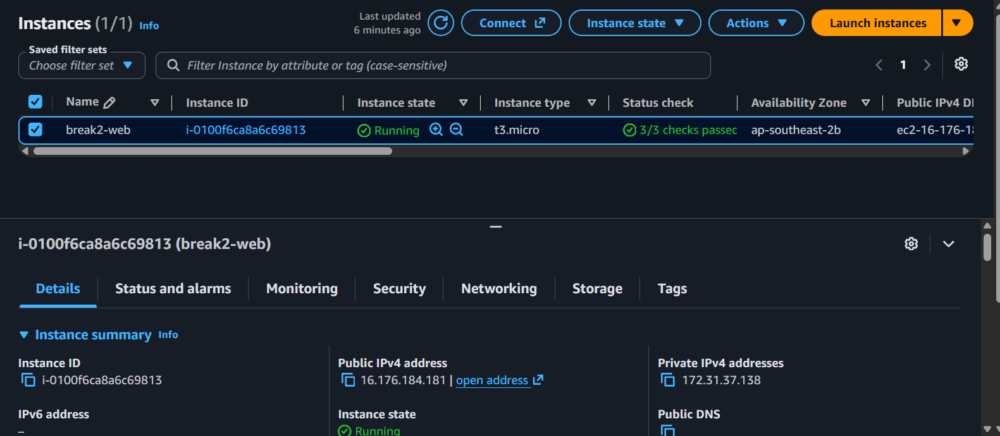
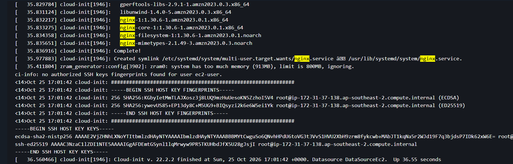
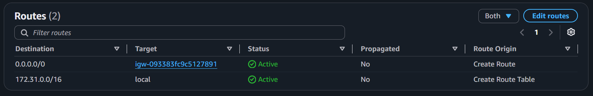
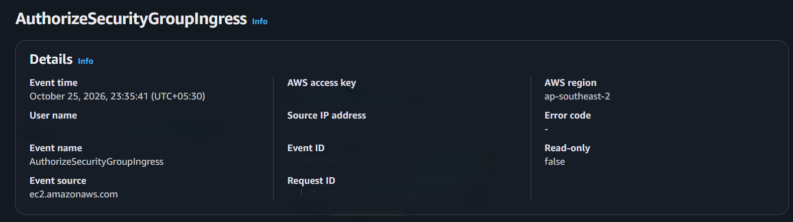
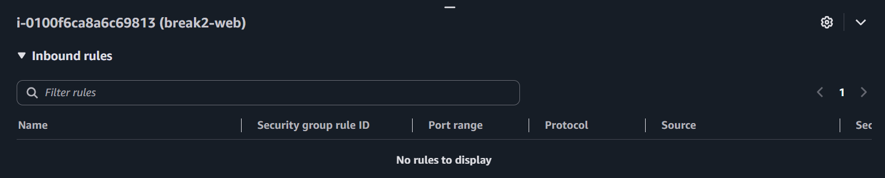
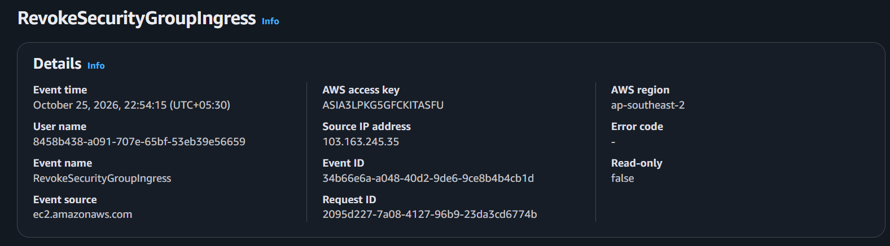
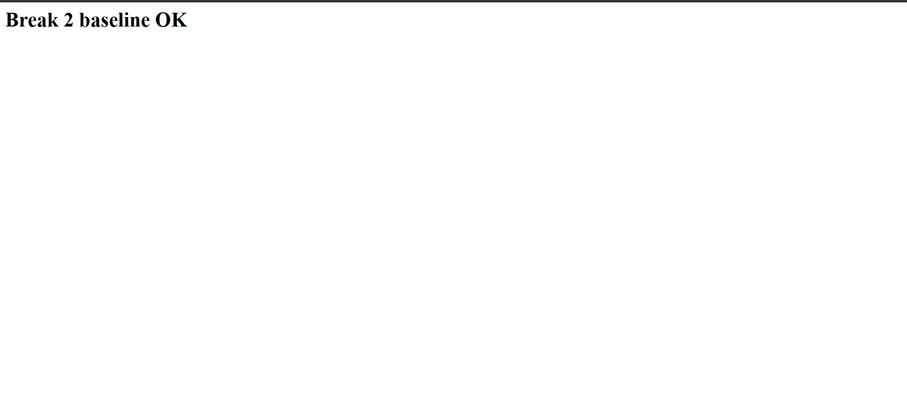

# Incident 02: Web server timing out (missing security group rule)

**Severity:** Low (lab instance) | **Region:** ap-southeast-2

## Timeline
- Launched `break2-web` (Amazon Linux 2023, t3.micro) with nginx via user data
- Baseline verified: page served over HTTP
- Removed the inbound HTTP (port 80) rule from the security group
- Browser returned ERR_CONNECTION_TIMED_OUT
- Investigated, found the missing rule, re-added it
- Page served again

## Symptom
The site timed out (`ERR_CONNECTION_TIMED_OUT`) while the instance showed as running.

## Hypotheses, in the order I tested them
1. Host is down or unhealthy
2. App was never installed or failed to start
3. No route to the internet (route table)
4. Network ACL blocking traffic
5. Security group missing an inbound rule

## Evidence checked
| Check | Result | Ruled out? |
|---|---|---|
| Instance state and status checks | Running, 3/3 passed | Host failure |
| System log (cloud-init) | nginx installed, symlink created, cloud-init finished without errors | App install failure |
| Route table | 0.0.0.0/0 to an internet gateway, Active | Routing |
| Network ACL | [Default: allow-all inbound and outbound] | NACL |
| Security group inbound rules | No rule for TCP 80 | **Root cause** |
| CloudTrail | `RevokeSecurityGroupIngress` found at [time] | Confirms the change |

## Root cause
The security group `break2-web-sg` had no inbound rule for TCP port 80. The security group drops unsolicited inbound traffic that no rule allows, so the connection never reached nginx.

## Fix
Added an inbound rule: HTTP, TCP 80, source 0.0.0.0/0. The page loaded immediately, because security group changes apply without a restart. CloudTrail shows `AuthorizeSecurityGroupIngress` as the fix event.

## Prevention
- Manage security groups with infrastructure as code so manual drift is visible
- Create a CloudWatch alarm on security group change events (planned for the monitoring phase)
- Restrict who can edit security groups using IAM
- Keep a documented baseline of expected inbound rules per service

## What I learned
- A **timeout** means packets are dropped before reaching the app (security group, NACL, route, or host down)
- **Connection refused** means the host answered but nothing was listening
- **502/503/504** means a load balancer or upstream app responded with an error
- Checking the layers in order, and writing down what each check ruled out, gets to the cause faster than guessing

## Evidence
**Baseline**

**Failure and investigation**

**Recovery**

