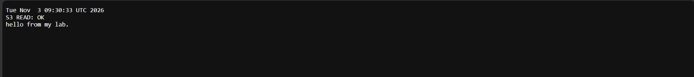
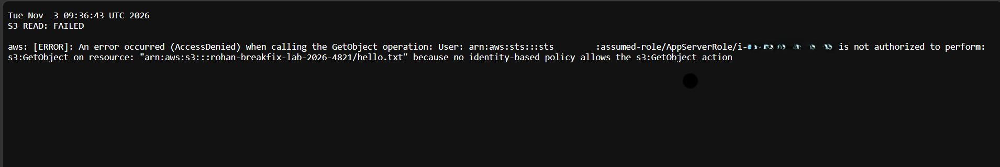
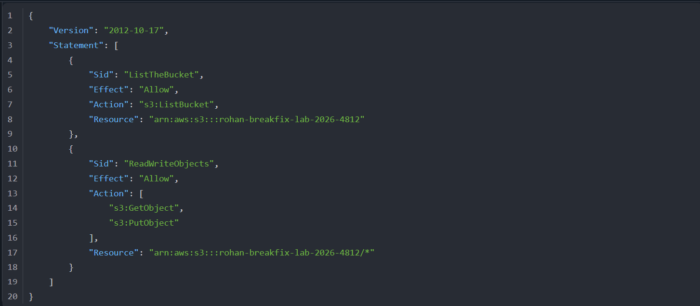
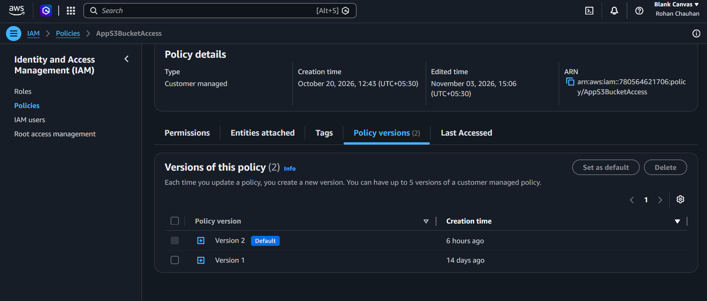
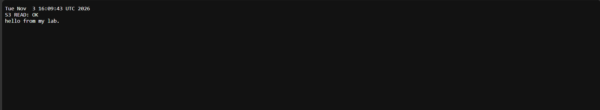

# Incident 03: EC2 instance denied access to S3 (policy typo)

**Severity:** Medium in production (lab here) | **Region:** ap-southeast-2

## Timeline (Nov 3, 2026, UTC)
- 09:30: Status page reported S3 READ: OK (instance role AppServerRole)
- [time from Policy versions tab]: Policy AppS3BucketAccess edited; bucket name in both Resource lines changed by a typo
- 09:36: Status page reported S3 READ: FAILED (AccessDenied)
- Investigated; found the mismatched bucket name
- [time from fixed-ok screenshot]: Policy corrected; S3 READ: OK restored

## Symptom
The app could no longer read from S3. The status page reported AccessDenied for
s3:GetObject by the instance role.

## Hypotheses, in the order I tested them
1. Instance is unhealthy
2. Instance has the wrong or no role
3. Policy detached from the role
4. Policy content doesn't cover the bucket
5. Explicit Deny somewhere (bucket policy)

## Evidence checked
| Check | Result | Ruled out? |
|---|---|---|
| Error message | AccessDenied; "no identity-based policy allows" s3:GetObject on the real bucket | Points to a missing Allow, not an explicit Deny |
| Instance status | Running, 3/3 passed | Host failure |
| Instance IAM role | AppServerRole attached | Wrong or missing role |
| Role permissions | AppS3BucketAccess attached | Detached policy |
| Policy JSON | Resource ARNs name ...4812; the real bucket is ...4821 | **Root cause** |
| Bucket policy | None | Explicit Deny |
| Policy versions | New default version after the edit | Confirms a recent change |

## Root cause
A typo in the bucket name in the customer-managed policy's Resource ARNs. The role
therefore had no Allow for the real bucket, so S3 returned an implicit deny.

## Fix
Set the previous policy version as default (or corrected both Resource lines).
The status page returned to OK within about a minute.

## Side finding: baseline timeout
The baseline page first timed out in one browser while the instance showed healthy,
the public IP matched, and the security group allowed my address. The same URL
loaded in a second browser, so the fault was client-side, not infrastructure.
Lesson: test from a second client or network before changing server-side settings.

## Prevention
- Validate policies with IAM Access Analyzer before saving
- Manage policies as infrastructure as code with review
- Use policy versions to roll back quickly
- Alarm on IAM policy changes (CreatePolicyVersion) in the monitoring phase

## What I learned
- Implicit deny ("no identity-based policy allows") means a missing Allow; an explicit deny names a Deny statement
- Always read the full error: it names the principal, the action, and the resource
- One wrong character in an ARN is enough for an outage
- Policy versions give a fast rollback

## Evidence

**Baseline**

**Failure and investigation**

**Recovery**

