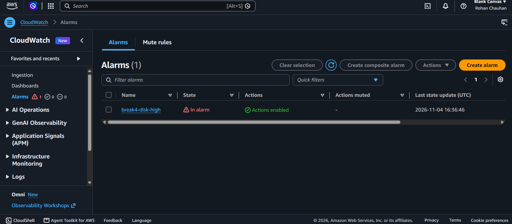
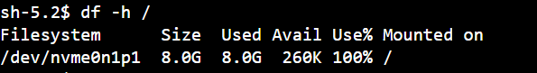

# Incident 04: Disk full on EC2 (alarm fired, service stalled)

**Severity:** Medium in production (lab here) | **Region:** ap-southeast-2

## Timeline (UTC)
- [time]: Baseline: status page updating, disk at about 20%
- [time]: Disk crossed 80%; CloudWatch alarm break4-disk-high went to In alarm; email received
- [time]: Disk reached 100%; status page timestamp stopped updating
- [time]: Large files located and removed
- [time]: Page updating again; alarm returned to OK

## Symptom
The page was still served but its timestamp froze. EC2 status checks stayed 3/3.

## Hypotheses, in the order I tested them
1. Network or security group problem
2. Web server down
3. Instance unhealthy
4. Disk space exhausted

## Evidence checked
| Check | Result | Ruled out? |
|---|---|---|
| Page loads in browser | Served, but stale | Network, security group, nginx |
| EC2 status checks | 3/3 passed | Host failure (and shows they miss disk issues) |
| CloudWatch alarm | In alarm at 80%; metric reached 100% | Confirms resource exhaustion |
| df -h / | 100% used, 0 available | **Root cause** |
| du and ls on /var/tmp | Large fill*.img files | Source of usage |
| journalctl for statuscheck | "No space left on device" | Explains the frozen page |

## Root cause
The root volume filled to 100%, so the status script could no longer write. The
service stayed up but stopped doing its work.

## Fix
Deleted the large files in /var/tmp. The script resumed on its next run, and the
alarm returned to OK.

## Prevention
- Alarm on disk used_percent at 80% (this worked: the alert came before the outage)
- Log rotation and cleanup jobs; send logs off the instance
- Right-size the volume, or use a separate volume for data
- Monitor what EC2 status checks do not cover (disk, memory) with the CloudWatch agent

## What I learned
- Green status checks do not mean a healthy application
- Metrics such as disk and memory need the CloudWatch agent; they are not collected by default
- An alarm at 80% gives time to act before 100%
- Session Manager gave me a shell with no SSH port open and no keys

## Evidence
**Baseline**

**Failure and investigation**

**Recovery**

