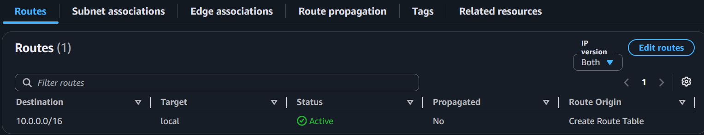
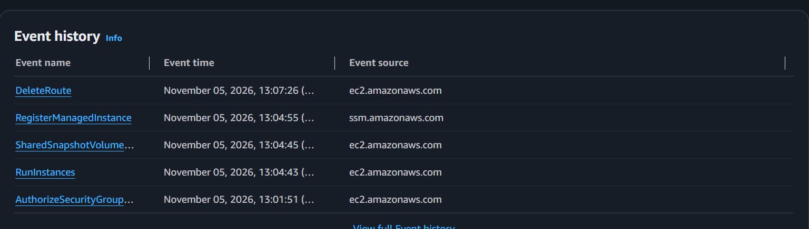

# Incident 05: Web server timing out (missing internet route)

**Severity:** High in production (lab here) | **Region:** ap-southeast-2

## Symptom
ERR_CONNECTION_TIMED_OUT while the instance showed running with 3/3 status checks.

## Hypotheses, in the order I tested them
1. Instance unhealthy
2. Security group not allowing my address
3. Network ACL blocking traffic
4. No route to the internet gateway

## Evidence checked
| Check | Result | Ruled out? |
|---|---|---|
| Instance status | Running, 3/3 passed | Host failure |
| Security group | HTTP 80 allowed from my current IP | Security group |
| Network ACL | Default: allow all | NACL |
| Route table | Only 10.0.0.0/16 local; no 0.0.0.0/0 | **Root cause** |
| CloudTrail | DeleteRoute event | Confirms the change |

## Root cause
The subnet's route table had no 0.0.0.0/0 route to the internet gateway, so reply
traffic had no path out. The connection timed out even though the instance and the
security group were healthy.

## Fix
Added 0.0.0.0/0 pointing to the internet gateway. Access returned immediately.

## Prevention
- Manage route tables as infrastructure as code so manual drift shows
- Restrict route table edits with IAM
- Alarm on DeleteRoute and related events
- Use the VPC resource map to check connectivity after changes

## What I learned
- A timeout can come from the security group (Incident 02) or the route table (this one); the evidence is what tells them apart
- Status checks passing does not mean the instance is reachable
- A subnet is public because its route table points to an internet gateway

## Evidence

**Baseline**

**Failure and investigation**

**Recovery**

