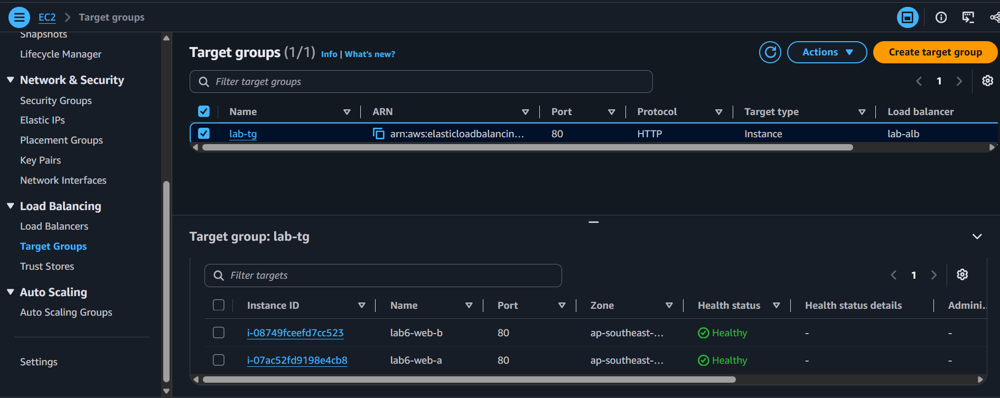
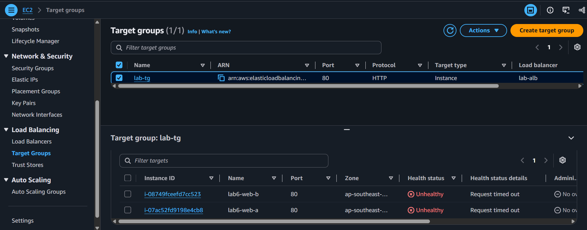
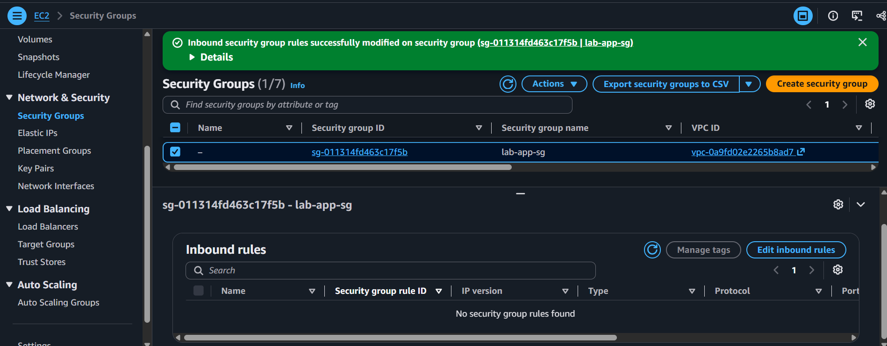

# Incident 06: ALB returning 504 (targets unreachable from the load balancer)

**Severity:** High in production (lab here) | **Region:** ap-southeast-2

## Symptom
The site returned an HTTP 5xx from the load balancer while both instances showed
running with 3/3 status checks.

## Hypotheses, in the order I tested them
1. Instances down
2. Wrong health check path or port
3. Load balancer's own security group or listener
4. App security group not allowing the load balancer

## Evidence checked
| Check | Result | Ruled out? |
|---|---|---|
| Browser response | HTTP error page from the ALB | ALB and its SG reachable |
| Target health | Unhealthy, "Request timed out" | Points to a network block |
| Instance status | Running, 3/3 passed | Host failure |
| Health check config | /health on port 80, worked earlier | Wrong path or port |
| lab-app-sg inbound rules | No rule allowing lab-alb-sg | **Root cause** |

## Root cause
The app security group no longer allowed traffic from the load balancer's security
group, so health checks and requests timed out and the ALB returned a gateway error.

## Fix
Re-added an inbound HTTP rule on lab-app-sg with the source set to lab-alb-sg.
Targets became healthy about a minute later.

## Prevention
- Define the security group chain in infrastructure as code
- Reference security groups (not IPs) so the chain survives instance changes
- Alarm on UnHealthyHostCount and on security group change events
- Restrict who can edit security groups

## What I learned
- 502, 503, and 504 point behind the load balancer, not at it
- "Request timed out" in target health means a network block; a path or response mismatch looks different
- Referencing a security group as the source is how the 3-tier chain works

## Evidence

**Baseline**

**Failure and investigation**

**Recovery**

