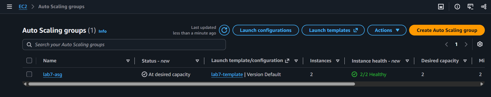
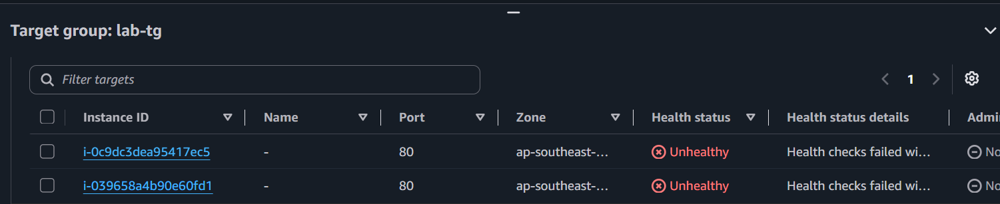
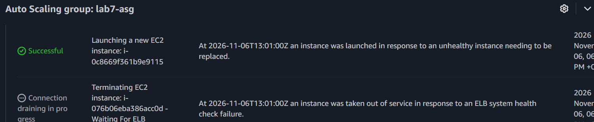
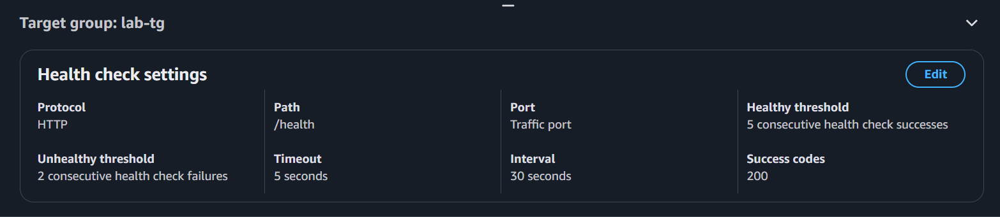
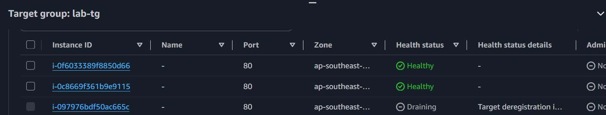

# Incident 07: Wrong health check path caused instance replacement loop

**Severity:** High in production (lab here) | **Region:** ap-southeast-2

## Symptom
All targets unhealthy and the ASG repeatedly replacing instances. Site behavior
during the fault: [describe what you saw].

## Hypotheses, in the order I tested them
1. Network or security group block
2. Instances unhealthy
3. Health check path or response code mismatch

## Evidence checked
| Check | Result | Ruled out? |
|---|---|---|
| Target health reason | "Failed with codes [404]" | Network block (a response came back) |
| Instance status | 3/3 passed | Host failure |
| Health check config | Path /healthcheck; app serves /health | **Root cause** |
| ASG activity | Terminations for failed ELB health checks | Explains the loop |

## Root cause
The target group health check path pointed at a URL the app doesn't serve. Every
target failed the check, and because ELB health checks were enabled on the ASG, it
treated healthy servers as failed and replaced them.

## Fix
Restored the health check path to /health. Targets recovered within about a minute.

## Prevention
- Define health check settings in infrastructure as code with review
- Alarm on UnHealthyHostCount and on ModifyTargetGroup events
- Test health check changes on one target group before production
- Use a generous grace period

## What I learned
- 404 in target health means the server answered; a timeout means a network block
- ASG with ELB health checks acts on the load balancer's verdict, so a bad check can cause instance churn
- ALB behavior when all targets are unhealthy: [what I observed]

## Evidence

