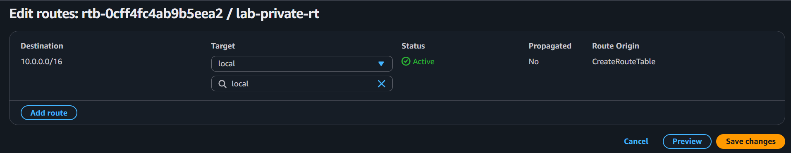
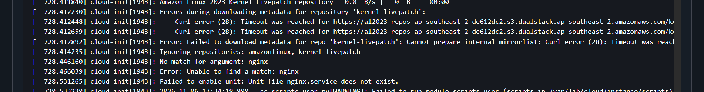

# Incident 08: Private instances lost outbound internet (missing NAT route)

**Severity:** Medium in production (lab here) | **Region:** ap-southeast-2

## Symptom
Private instances could not reach the internet or install packages; Session Manager
failed to connect to the new instance.

## Hypotheses, in the order I tested them
1. Instance unhealthy
2. Security group outbound rule
3. Network ACL
4. NAT gateway failure
5. Missing route to the NAT gateway

## Evidence checked
| Check | Result | Ruled out? |
|---|---|---|
| Instance status | 3/3 passed | Host failure |
| Security group outbound | Default allow-all | Security group |
| Network ACL | Default allow-all | NACL |
| NAT gateway state | Available | NAT failure |
| Private route table | No 0.0.0.0/0 route | **Root cause** |
| System log (new instance) | Package repository download errors | Explains the failed install |

## Root cause
The private subnet's route table had no 0.0.0.0/0 route to the NAT gateway, so
outbound traffic had no path off the subnet.

## Fix
Added 0.0.0.0/0 pointing at the NAT gateway. Connectivity returned immediately.

## Prevention
- Define routes as infrastructure as code
- Alarm on DeleteRoute events
- Use VPC endpoints for critical AWS services (such as SSM) so a NAT outage doesn't cut management access
- Bake dependencies into AMIs so boot doesn't need the internet

## What I learned
- A private subnet reaches the internet only through a route to NAT
- A healthy NAT gateway is useless without a route pointing at it
- User data runs once at first boot, so a failed install isn't retried
- Session Manager also depends on outbound connectivity

## Evidence

