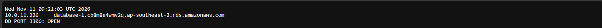
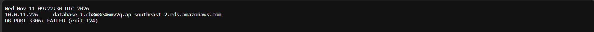
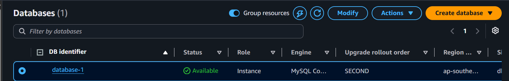
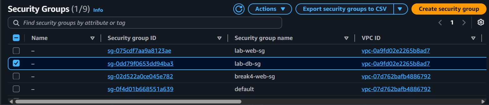
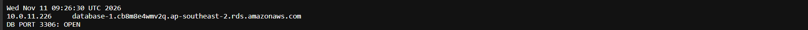

# Incident 09: App could not reach the database (security group rule removed)

**Severity:** High in production (lab here) | **Region:** ap-southeast-2

## Symptom
The app's database connectivity check reported FAILED (timeout, exit 124) while the
web page itself kept loading.

## Hypotheses, in the order I tested them
1. Web server or its security group
2. Database stopped or unhealthy
3. Database security group not allowing the app
4. Network ACL or routing

## Evidence checked
| Check | Result | Ruled out? |
|---|---|---|
| Web page loads | Yes | Web tier and its SG |
| Failure type | Timeout, DNS resolved | Wrong endpoint; points to a network block |
| RDS status | Available, no recent events | Database down |
| lab-db-sg inbound rules | No rule for port 3306 | **Root cause** |
| NACL and routes | Defaults, local route | Network path |
| CloudTrail | RevokeSecurityGroupIngress | Confirms the change |

## Root cause
The database security group no longer allowed port 3306 from the app's security
group, so connection attempts were silently dropped.

## Fix
Re-added an inbound MySQL/Aurora rule on lab-db-sg with the app security group as source.

## Prevention
- Define security groups in infrastructure as code
- Alarm on security group changes and on application database errors
- Restrict who can edit security groups
- Reference security groups, not IPs, as sources

## What I learned
- A timeout cannot tell a blocked DB from a stopped DB; check the DB's status next
- Security-group-as-source is how a 3-tier chain works
- A credential-free port check separates network faults from login faults

## Evidence

