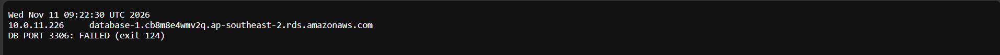
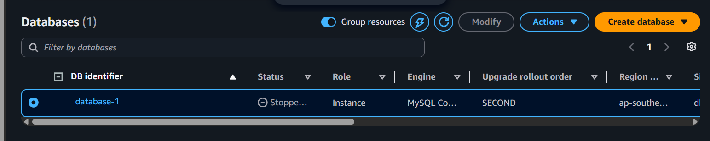
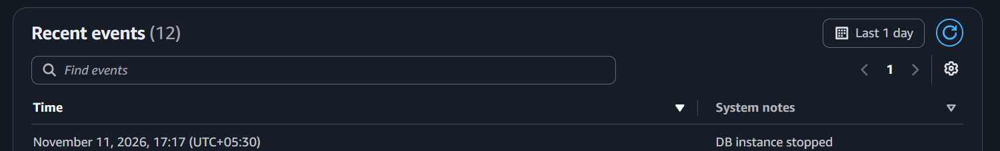
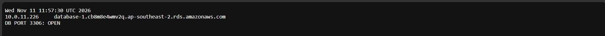

# Incident 10: Database stopped (detection, triage, recovery)

**Severity:** Critical in production (lab here) | **Region:** ap-southeast-2

## Symptom
Database connectivity check failed. Web tier healthy. Observed behavior:
[DNS result and failure line you saw].

## Hypotheses, in the order I tested them
1. Security group change (as in Incident 09)
2. Database stopped
3. Network or routing issue

## Evidence checked
| Check | Result | Ruled out? |
|---|---|---|
| Alert email | RDS availability event received | Confirms detection path works |
| lab-db-sg | 3306 rule still present | Security group |
| RDS status | Stopped | **Root cause** |
| RDS events | "DB instance stopped" | Confirms state change |
| CloudTrail | StopDBInstance by [who] | Who and when |

## Root cause
The database instance was stopped manually, so nothing was listening.

## Fix
Started the instance from the RDS console; it became Available in about [N] minutes.

## Prevention
- Restrict stop and delete permissions (IAM, or deny on production instances)
- Tag production resources and require tags for permissions
- Keep event subscriptions and alarms in place (they caught this one)
- Note that stopped RDS instances restart automatically after a set period (check current AWS docs)
- Document a start procedure and the expected recovery time

## What I learned
- The same timeout can come from a block or from a stopped database; the DB's status separates them
- Event subscriptions turn state changes into alerts
- Time to recovery is the number that matters in incident reports
- Check the cheap, quick causes first, then the expensive ones

## Evidence

