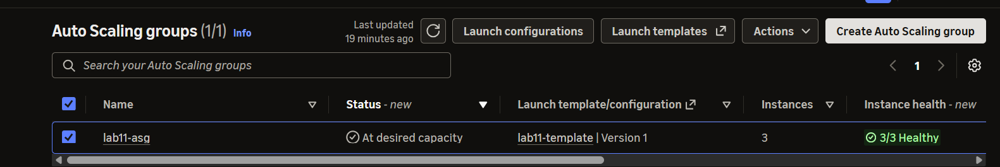
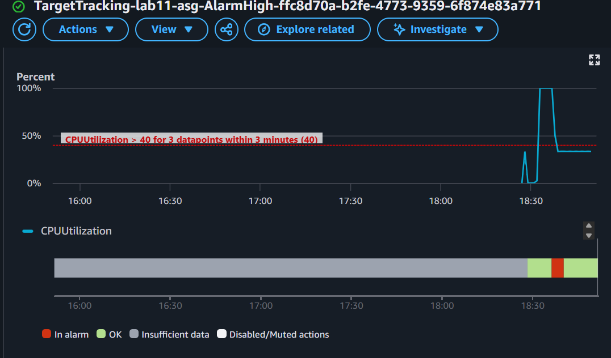
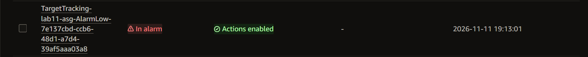
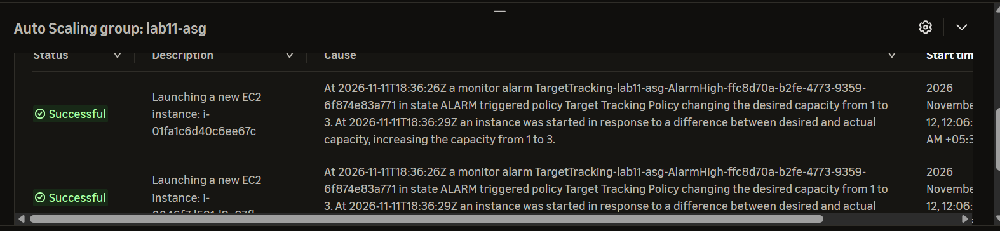
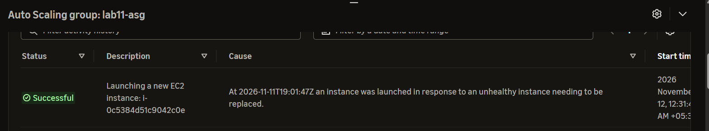

# Incident 11: CPU spike, auto scaling response, and instance replacement

**Severity:** Medium in production (lab here) | **Region:** ap-southeast-2

## Symptom
Sustained 100% CPU on one instance. Separately, a stopped web server was not detected
by the Auto Scaling group.

## Hypotheses, in the order I tested them
1. A runaway application process
2. Insufficient capacity for the load
3. Monitoring or scaling misconfigured

## Evidence checked
| Check | Result | Ruled out? |
|---|---|---|
| CloudWatch CPUUtilization | Climbed to ~100% | Confirms resource exhaustion |
| top inside the OS | Two "yes" processes using both vCPUs | Identifies the source (deliberate load) |
| CloudWatch alarm | In alarm after sustained high average | Monitoring works |
| ASG activity | New instances launched on the alarm | Scaling works |
| Manual termination | ASG launched a replacement | Desired capacity enforced |
| nginx stopped | No ASG action; status checks 3/3 | EC2 health checks cannot see the app |

## Root cause
CPU load saturated the instance. The target tracking policy added capacity as
designed. The group did not react to the stopped web server because only EC2
health checks were enabled, and the host stayed healthy.

## Fix
Stopped the load; capacity stayed until the slow scale-in alarm. Restarted nginx.
For app-level detection, attach a load balancer and enable ELB health checks.

## Prevention
- Alarm on sustained CPU and on memory/disk with the CloudWatch agent
- Use ELB health checks so the ASG sees application failures (see Incident 07)
- Set sensible min/max sizes and warm-up times
- Load-test before launch; use the scaling cooldowns on purpose

## What I learned
- Target tracking creates and manages its own alarms
- Scale-out reacts in minutes; scale-in is deliberately slower (about 15 minutes)
- An ASG with only EC2 health checks replaces dead hosts, not dead apps
- Detailed monitoring gives 1-minute data and faster reactions, at a small cost

## Evidence

