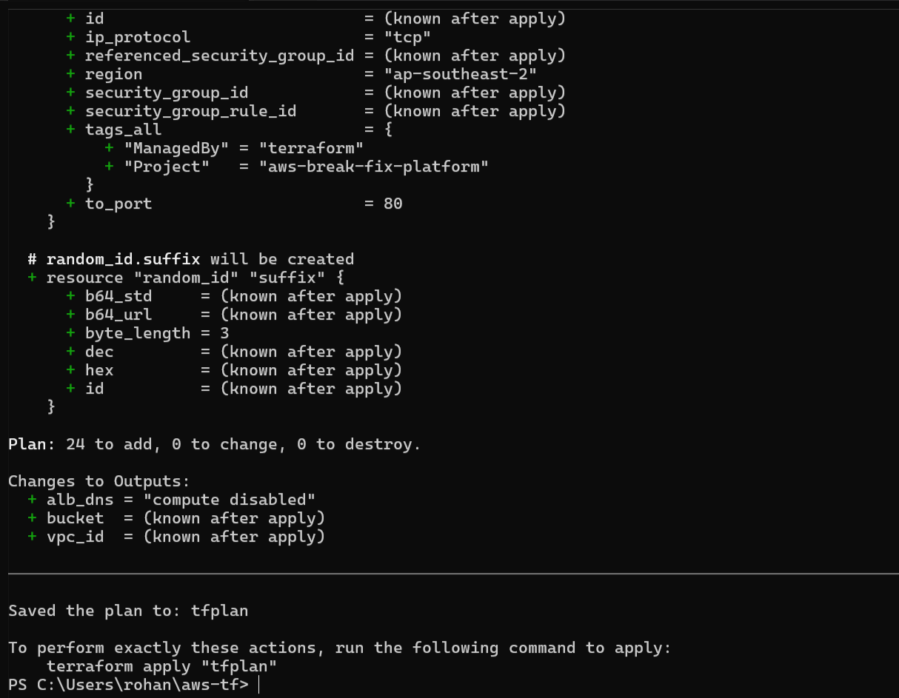
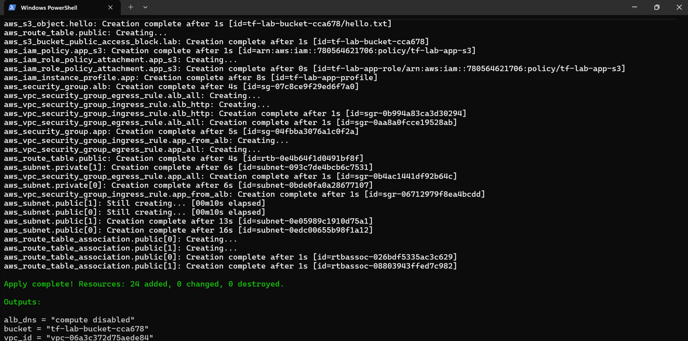
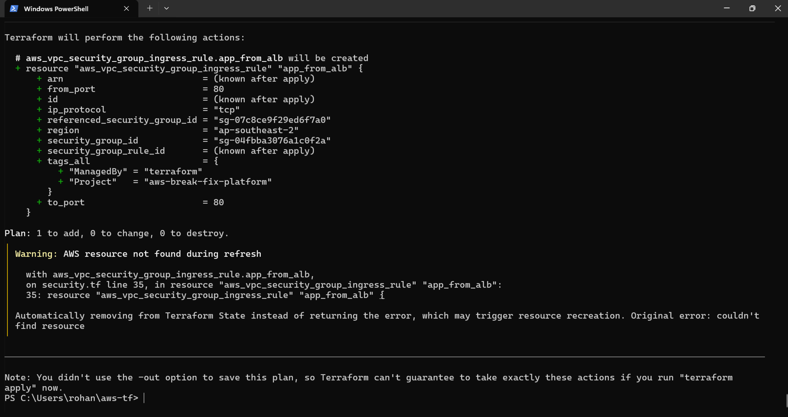
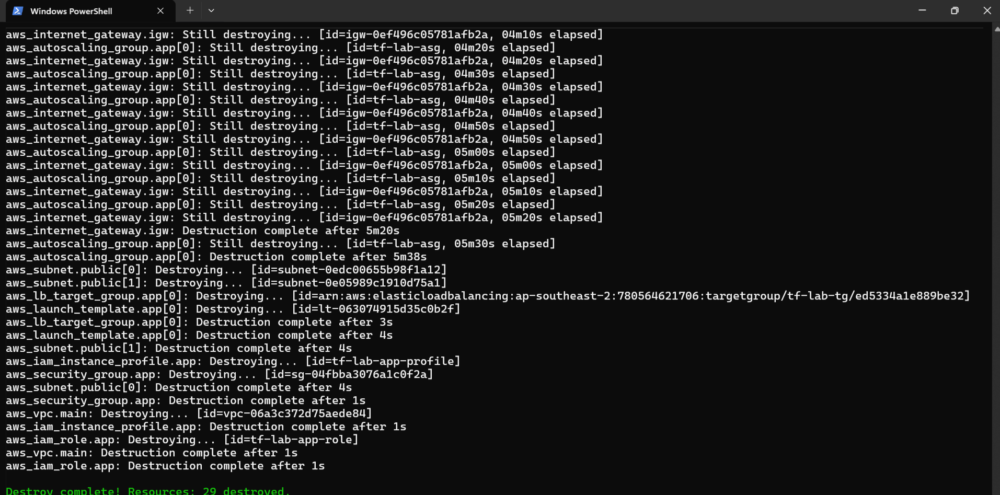
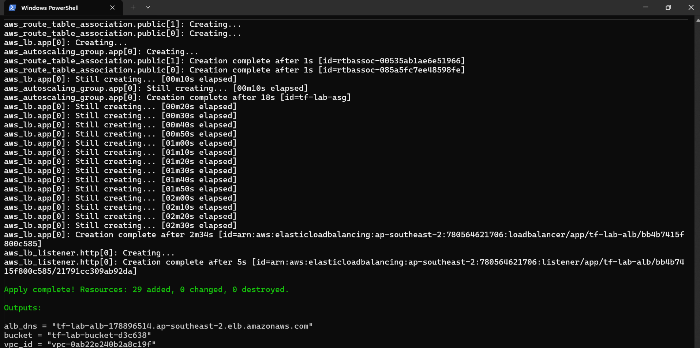

# Terraform

Rebuilds the break-fix platform in ap-southeast-2: VPC, public and private subnets,
internet gateway, security group chain, S3 bucket, least-privilege IAM role, and
(optional) an ALB with a 2-instance Auto Scaling group.

## Use
1. Copy `terraform.tfvars.example` to `terraform.tfvars` and set your IP.
2. `terraform init` then `terraform plan` then `terraform apply`
3. Add `-var="enable_compute=true"` for the ALB and ASG (billed hourly)
4. `terraform destroy` when done

## Design notes
- `enable_compute` keeps the free network layer separate from the billed compute layer
- Instances run in public subnets to avoid NAT Gateway cost; private subnets are
  provisioned for the future database tier
- Security group chain: ALB SG allows my IP, app SG allows only the ALB SG
- No access keys anywhere: the instance role provides S3 access, and I authenticate
  locally with short-lived console credentials
- State is local (solo lab); a team setup would use an S3 backend with locking

## Proof it works
- Drift test: manually deleted the app SG rule; `terraform plan` detected it
- Destroy and rebuild completed in about [N] minutes

## Screenshots

